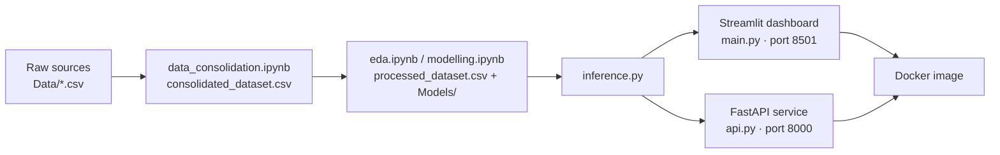
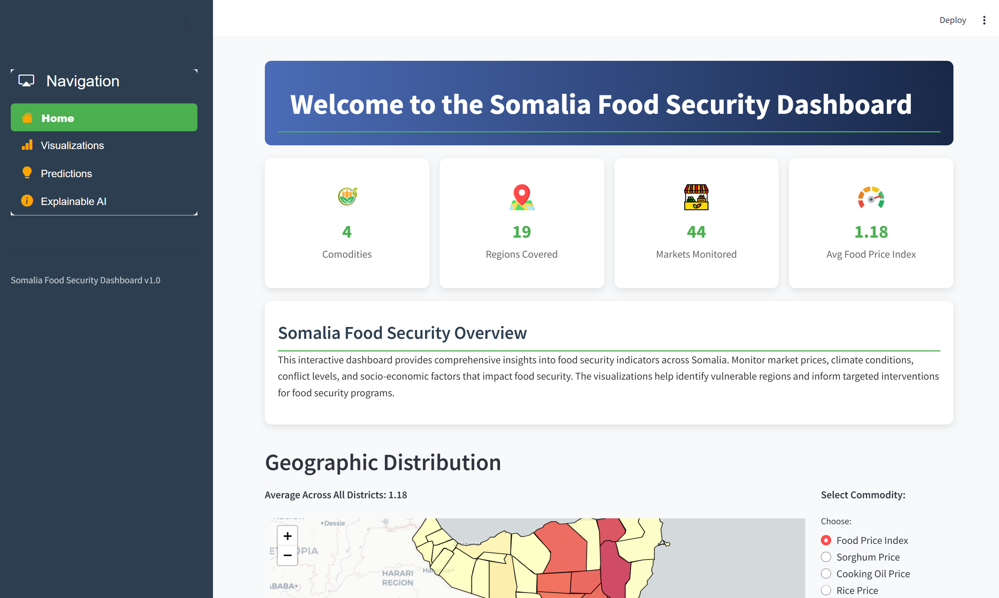
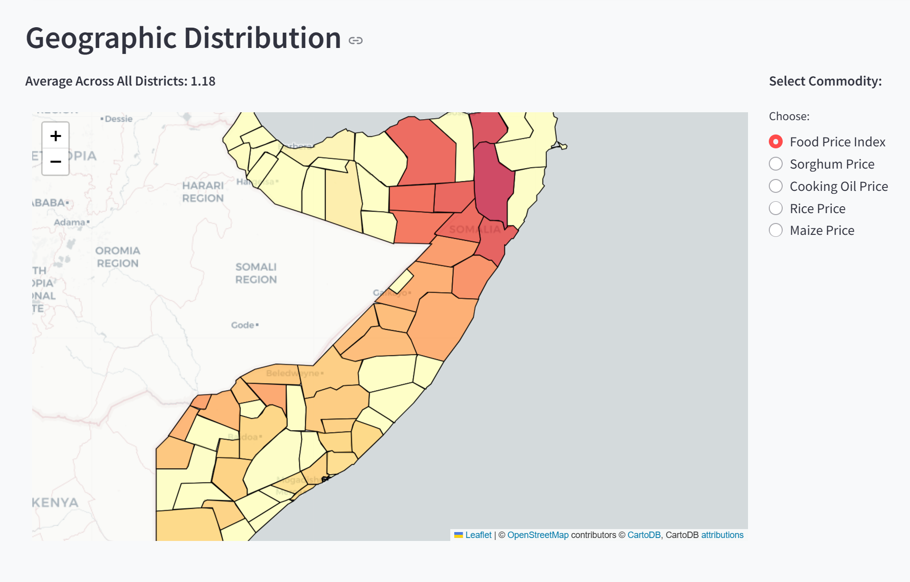
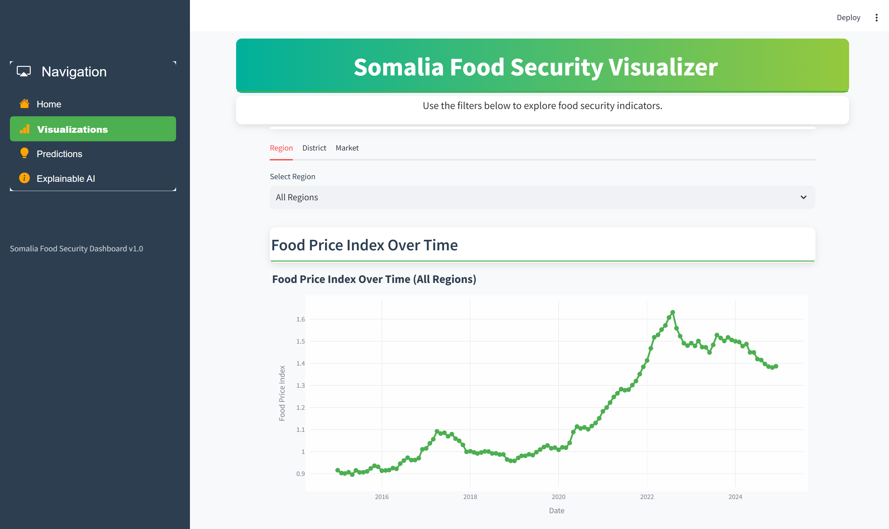
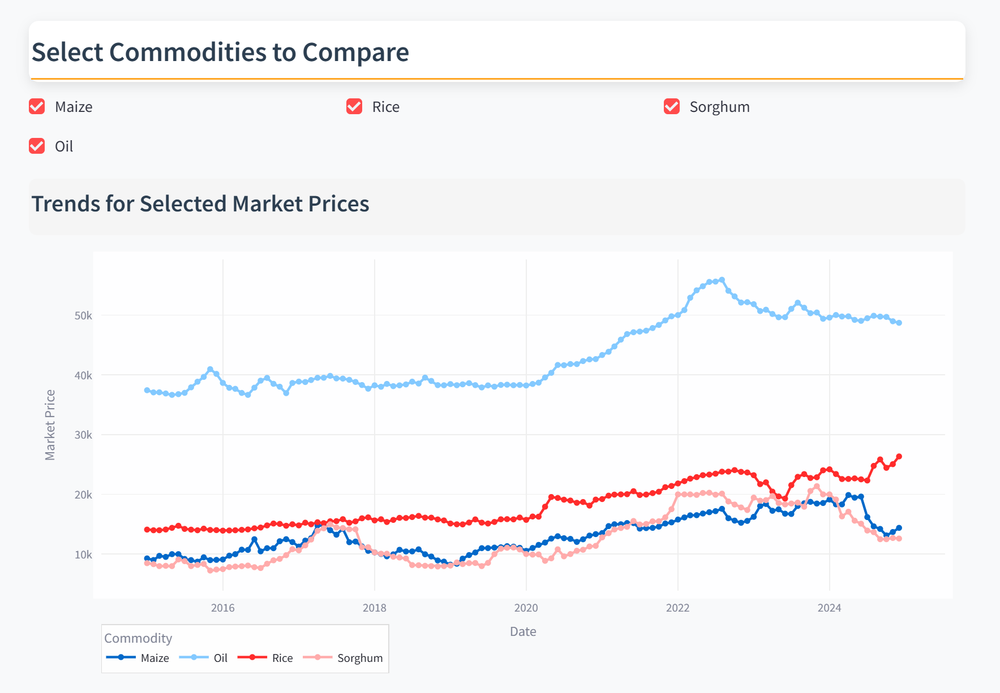
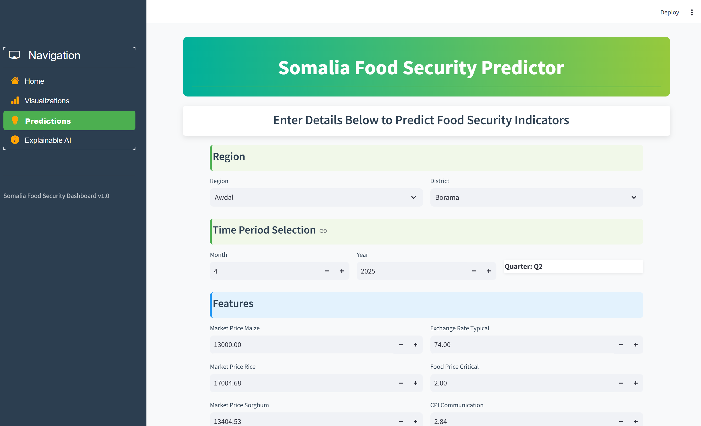
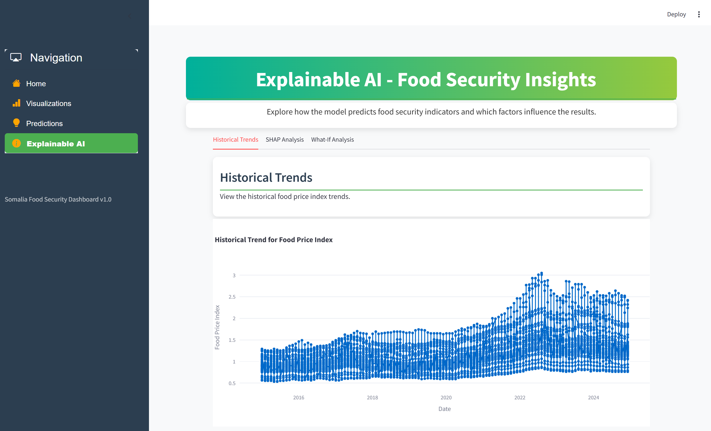
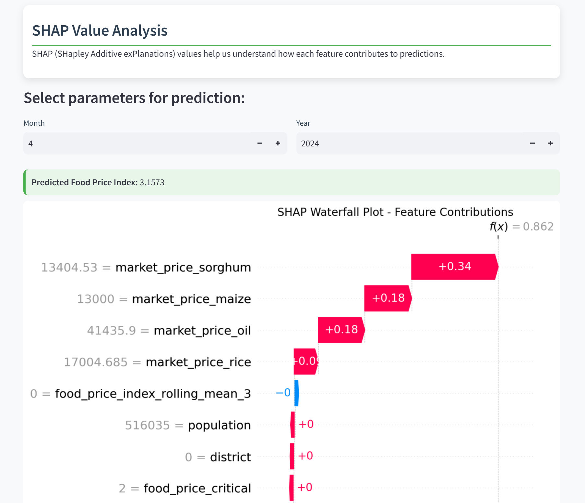
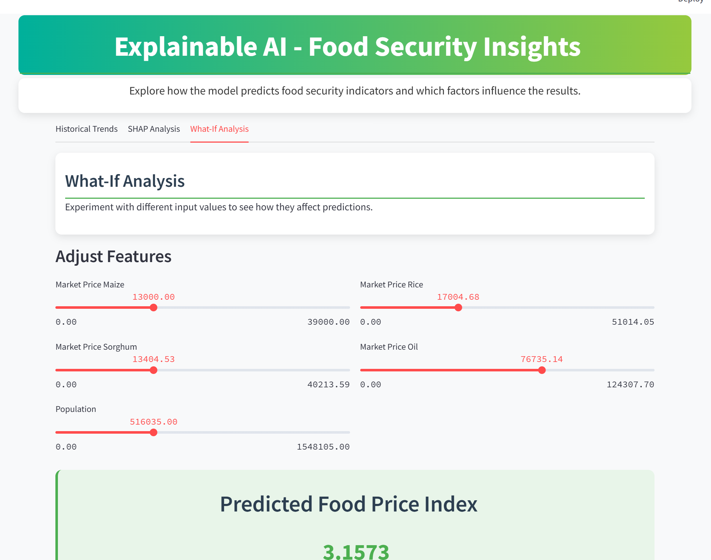

### Somalia Food Security Dashboard

Forecasting and monitoring of the market-level **Food Price Index (FPI)** in Somalia under climate, conflict and macroeconomic shocks. A Streamlit dashboard for exploring prices across markets, forecasting the FPI month by month, and running what-if scenarios on its drivers.

**Data:** 5,778 market-month observations, 44 markets, 19 regions, January 2015 – December 2024.

### Quick start (Docker)

Requires Docker with Compose.

```bash
docker compose up --build
```

| Service | URL |
|---|---|
| Dashboard | <http://localhost:8501> |
| Prediction API | <http://localhost:8000> (interactive docs at `/docs`) |

To change ports: `PORT=8080 API_PORT=9000 docker compose up --build`.

Stop with `docker compose down`.

### Run locally

Python 3.12.

```bash
python -m venv .venv && source .venv/bin/activate
pip install -r requirements.txt
cd System/App
streamlit run main.py            # dashboard on :8501
uvicorn api:app --port 8000      # API on :8000
```

### Architecture



| Page | What it does |
|---|---|
| Home | Headline metrics, FPI stress band, market map |
| Visualizations | Price and FPI trends by region, market and commodity |
| Predictions | Recursive month-by-month FPI forecast for a chosen market |
| Explainable AI | What-if analysis of each driver's effect on the forecast |

### Screenshots

| Home | Market map |
|---|---|
|  |  |

| FPI trend | Commodity price trend |
|---|---|
|  |  |

| Forecast | Historical trends |
|---|---|
|  |  |

| SHAP analysis | What-if analysis |
|---|---|
|  |  |

### API

Both services share one image and one `inference` module, so the API and the dashboard always serve the same model.

| Method | Endpoint | Purpose |
|---|---|---|
| GET | `/health` | Liveness check |
| GET | `/markets` | Regions and the markets in each |
| POST | `/predict` | FPI for one market-month |
| POST | `/forecast` | Recursive forecast, 1 to 24 months after the last observation |

Only `region` and `district` (market) are required. Any driver left out (commodity prices, population, exchange-rate and food-price indicators, CPI components) defaults to that market's latest observed value, so you send only what you want to change.

```bash
curl -X POST localhost:8000/forecast -H 'Content-Type: application/json' \
  -d '{"region": "Awdal", "district": "Borama", "months": 3, "market_price_rice": 40000}'
```

```json
{
  "region": "Awdal",
  "district": "Borama",
  "last_observed": "2024-12",
  "inputs": { "market_price_rice": 40000.0, "...": "..." },
  "forecast": [
    { "date": "2025-01", "food_price_index": 0.83 },
    { "date": "2025-02", "food_price_index": 0.83 },
    { "date": "2025-03", "food_price_index": 0.89 }
  ]
}
```

Unknown markets return `404`; invalid values return `422`.

### Data

| Source | Variables |
|---|---|
| World Bank Real-Time Food Prices | Maize, rice, sorghum, vegetable oil prices; FPI |
| NASA POWER | Temperature, precipitation, humidity |
| Somalia National Bureau of Statistics | CPI by expenditure group |
| World Bank macro indicators | Exchange rate and related indicators |
| Shock indicators | Conflict, drought (NDVI, rainfall), exchange-rate, food-price and fuel-price stress |

Raw files are in [Data/](Data/). The app reads only `Data/processed_dataset.csv`.

### Model

**Hybrid LSTM + GRU-residual network** (TensorFlow/Keras), predicting the FPI for a market-month.

| Stage | Network | Trained on |
|---|---|---|
| Base | LSTM(64) → Dropout(0.2) → Dense(1) | Box-Cox-transformed FPI |
| Correction | GRU(32) → Dropout(0.2) → Dense(1) | Residuals of the base LSTM |

Prediction = LSTM output + GRU correction, then inverse Box-Cox back to the FPI scale.

- **Inputs (12):** region, market, prices of maize, rice, sorghum and oil, population, exchange-rate (typical) and food-price (critical) shock indicators, CPI communication, CPI housing and utilities, 3-month rolling mean of the FPI.
- **Preprocessing:** label-encoded region and market, `RobustScaler` on features, Box-Cox on the target. All fitted on the training split only.
- **Training:** Adam (lr 0.001), MSE loss, 40 epochs, batch size 32.
- **Evaluation:** chronological split, first 90% train, last 10% test.
- **Forecasting:** recursive. Each month's prediction updates the rolling mean used for the next month.

#### Results (test set, FPI scale)

| Model | MAE | RMSE | R² |
|---|---|---|---|
| **LSTM-GRU hybrid, regularized** | **0.0097** | **0.0150** | **0.9956** |
| **LSTM-GRU hybrid** | **0.0165** | **0.0271** | **0.9957** |
| XGBoost | 0.0259 | 0.0402 | 0.9906 |
| LightGBM | 0.0281 | 0.0424 | 0.9896 |
| Gradient Boosting | 0.0327 | 0.0475 | 0.9869 |
| Random Forest | 0.0350 | 0.0510 | 0.9849 |
| SARIMAX-GRU | 0.2201 | 0.3197 | 0.4063 |
| ARIMA-LSTM | 0.2686 | 0.3278 | 0.3757 |
| SARIMAX | 0.1878 | 0.3867 | 0.1314 |
| ARIMA | 0.3320 | 0.4195 | -0.0222 |
| LSTM | 0.3059 | 0.4195 | -0.0119 |
| BiLSTM | 0.3677 | 0.5139 | -0.5182 |
| GRU | 0.6787 | 0.7941 | -2.6257 |

Full comparison and training code: [modelling.ipynb](modelling.ipynb).

#### Artifacts ([Models/](Models/))

| File | Purpose |
|---|---|
| `lstm_model.h5`, `gru_model.h5` | Base LSTM and residual GRU |
| `scaler.pkl` | Feature scaler |
| `lambda_boxcox.pkl` | Box-Cox lambda for the target |
| `region_encoder.pkl`, `district_encoder.pkl` | Label encoders |
| `lstm_model_regularized.h5`, `gru_model_regularized.h5` | Regularized variant: GRU(8), L2 1e-4, dropout 0.1, early stopping |

### Repository layout

```
Data/                 Raw sources, consolidated and processed datasets
Models/               Trained models, scaler and encoders
System/App/           Dashboard (main.py), API (api.py), shared inference (inference.py)
System/Data/          Somalia GeoJSON for the map
*.ipynb               Consolidation, EDA and modelling notebooks
Dockerfile            Image definition (python:3.12-slim, non-root, healthcheck)
docker-compose.yml    Runs the dashboard and the API
```
